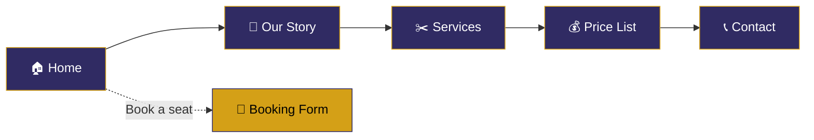

<div align="center">

<!-- Animated waving header -->


<!-- Typing animation -->
<a href="https://github.com/MALIK25252007/barber_shop">
  
</a>

<br/>

<a href="https://malik25252007.github.io/barber_shop/">
  
</a>
<a href="https://github.com/MALIK25252007/barber_shop">
  
</a>

<br/><br/>


</div>

---

## 💈 About The Project

**Barber Shop** is a modern, responsive website for a barbershop business. It showcases the shop's story, barbers, services, pricing, branches and a seat-booking form, all in one smooth single-page experience.

Built by **[Tarun Malik](https://github.com/MALIK25252007)**, the project is free to clone and use for personal projects. It's a great starting point if you want a clean website for a salon, barber shop or any local service business.

<div align="center">

```
✂️  Classic Cuts  •  💈 Fresh Styles  •  🧔 Beard Care  •  👶 Kids Haircuts
```

</div>

---

## ✨ Features

| | Feature | Description |
|---|---|---|
| 🏠 | **Hero Section** | Bold welcome banner with *About Us* and *What we do* shortcuts |
| 📖 | **Our Story** | Introduces the shop and the project |
| 💇 | **Meet the Barbers** | Profile cards for the barbers with social links |
| 🎁 | **Promo Banner** | 32% discount on every second week of the month using code **`MALIK`** |
| ✂️ | **Services** | Haircut, Washing, Shaves and Kids cuts with prices |
| 📅 | **Booking Form** | "Book a seat" form with a branch selector |
| 💰 | **Price List** | Clear pricing for haircut, beard trim, razor cut, shaves and styling/color |
| 📍 | **Branches** | Greater Noida, Aligarh and Bulandshahr |
| 📞 | **Contact** | Phone, email, WhatsApp, LinkedIn, Instagram and GitHub links |
| 📱 | **Responsive** | Works on mobile, tablet and desktop |

---

## 🌐 Live Preview

<div align="center">

### 👉 [**https://barbershope-comerse.vercel.app/**](https://barbershope-comerse.vercel.app/) 👈

</div>

---

## 🧭 Website Sections



---

## 💵 Services & Pricing

<div align="center">

| ✂️ Service | 💰 Price |
|:---|:---:|
| Haircut | ₹80 |
| Beard Trim | ₹40 |
| Razor Cut | ₹50 |
| Shaves | ₹70 |
| Styling / Color | ₹100 |
| Kids Haircut | ₹30 |
| Washing | ₹40 |

🎁 **Use promo code `MALIK` for 32% off on every second week of the month!**

</div>

---

## 📍 Our Branches

<div align="center">

| 🏙️ Branch | 📌 Location |
|:---|:---|
| **Greater Noida** | Near Knowledge Park 3 |
| **Aligarh, UP** | Near Chandaus, Gabhana |
| **Bulandshahr** | Near Khurja Junction, Panchvati, Khurja |

🕙 **Open Daily: 10:00 AM – 8:00 PM**

</div>

---

## 🛠️ Tech Stack

<div align="center">


</div>

- **HTML5** – page structure and semantic markup
- **CSS3** – styling, layout and responsive design
- **JavaScript** – interactivity and smooth navigation
- **GitHub Pages** – free hosting for the live site

---

## 📂 Project Structure

```
barber_shop/
├── 📁 css/          # Stylesheets
├── 📁 fonts/        # Custom fonts
├── 📁 images/       # Logo, barbers, services & banners
├── 📁 js/           # JavaScript files
├── 📄 index.html    # Main page
└── 📄 README.md     # You are here
```

---

## 🚀 Getting Started

**1. Clone the repository**

```bash
git clone https://github.com/MALIK25252007/barber_shop.git
```

**2. Go into the project folder**

```bash
cd barber_shop
```

**3. Open it in your browser**

Just double-click `index.html`, or use a local server such as the VS Code **Live Server** extension.

---

## 🎨 Customization

- **Branding:** replace the images in `/images`, including `logo.jpg`
- **Prices & services:** edit the service and price list sections in `index.html`
- **Contact details:** update the phone, email, branches and social links in the Contact section
- **Colors & fonts:** tweak the stylesheets in `/css` and `/fonts`

---

## 🗺️ Roadmap

- [x] Responsive landing page
- [x] Services and price list
- [x] Booking form UI
- [x] Multi-branch information
- [ ] Backend for real booking submissions
- [ ] Online payments
- [ ] Customer reviews section
- [ ] Admin dashboard

---

## 🏷️ Topics / Tags

<div align="center">

`barber-shop` `barbershop-website` `salon` `haircut` `grooming` `booking-system` `landing-page` `responsive-design` `html` `css` `javascript` `github-pages` `portfolio-project` `frontend` `web-development` `beginner-friendly` `open-source` `india`

</div>

> 💡 **Tip:** Add these as repository topics on GitHub (⚙️ next to *About* → *Topics*) so people can discover your project.

---

## 🤝 Contributing

Contributions, issues and feature requests are welcome!

1. 🍴 Fork the project
2. 🌿 Create your feature branch (`git checkout -b feature/AmazingFeature`)
3. 💾 Commit your changes (`git commit -m 'Add some AmazingFeature'`)
4. 📤 Push to the branch (`git push origin feature/AmazingFeature`)
5. 🔁 Open a Pull Request

---

## 📜 License

This project is free to clone and use for personal projects.

---

## 📬 Contact

<div align="center">

**Tarun Malik**

[](https://github.com/MALIK25252007)
[](https://www.linkedin.com/in/tarun-malik-9bab21388)
[](https://www.instagram.com/_malik_200716)
[](https://wa.me/918279630850)
[](mailto:Malik1642007@gmail.com)

<br/>

### ⭐ If you like this project, give it a star! ⭐


</div>
